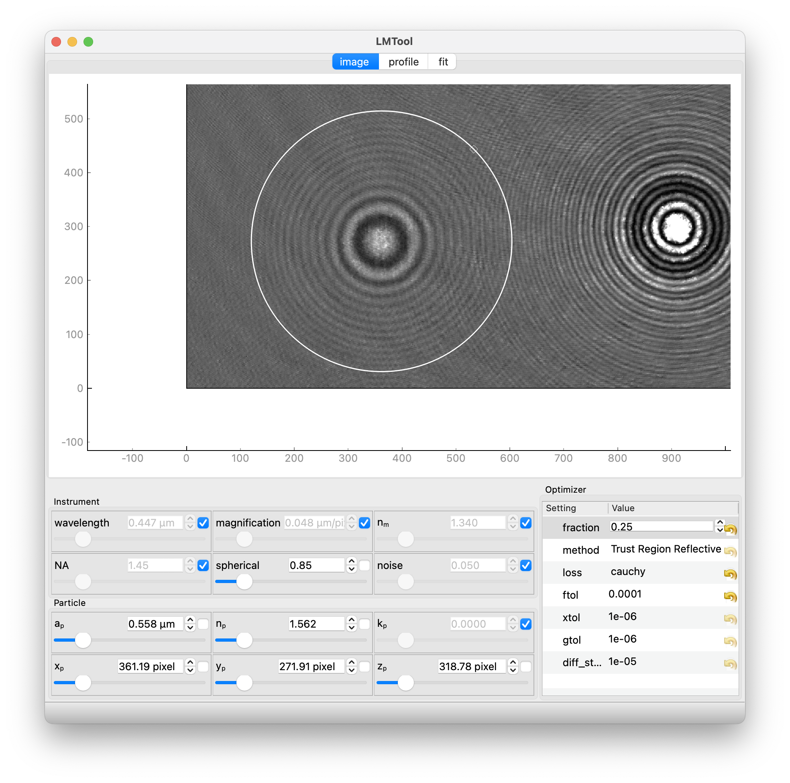
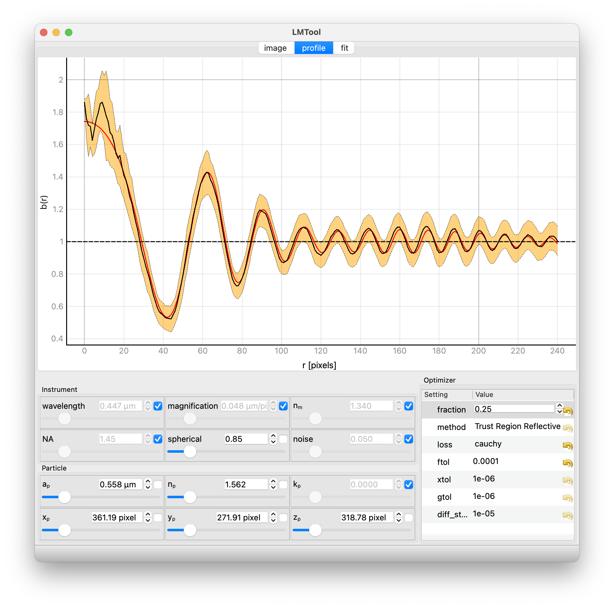
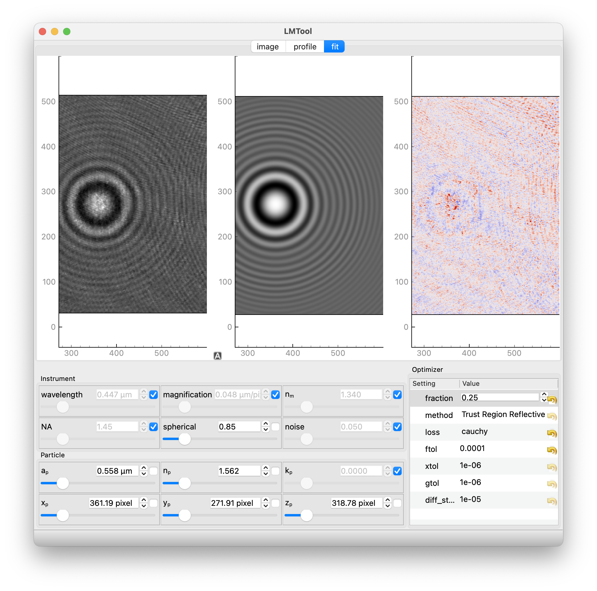

LMTool
======

**lmtool** is an interactive graphical application for loading holographic
microscopy images, positioning a region of interest around a particle, and
fitting a Lorenz-Mie scattering model to the hologram.

Launching
---------

**lmtool** needs a Qt binding, which pylorenzmie does not install by default:
``pip install pylorenzmie[gui]`` adds PyQt6 and PyTables (PyQt5, PySide2 and
PySide6 also work). Without PyTables, results are saved as JSON. Then launch from the command line::

    lmtool [image.png]

or equivalently::

    python -m pylorenzmie.lmtool [image.png]

Passing an image file loads it immediately on startup.  Without an
argument lmtool opens with a built-in example hologram.

Normalization
^^^^^^^^^^^^^

The Lorenz-Mie model predicts a hologram whose background intensity is 1,
so recorded images must be normalized before fitting.  lmtool normalizes
by dividing each pixel by the median pixel value of the image.  This works
well when most of the frame is background.

When a prerecorded background image is available, use it for higher-quality
normalization::

    lmtool image.png --background background.png

A scalar background value is also accepted (useful for 8-bit images with a
known camera offset)::

    lmtool image.png --background 100

A background image can also be loaded after startup via
**File → Open Background...**.  The status bar shows the background in use.  A
background that cannot be read is reported there and in the log, and the
previous one stays.  A background image must have the shape of the hologram:
otherwise the hologram is divided by its median, and the status bar says so.

Model
^^^^^

By default lmtool models the aberrations of the microscope as phase factors
(:func:`~pylorenzmie.theory.Aberrated.Aberrated`) and computes the
scattering with the fastest calculator that is available.  Two options
change that::

    lmtool image.png --distorted
    lmtool image.png --backend numpy

``-d`` or ``--distorted`` models the aberrations as geometric distortions
(:func:`~pylorenzmie.theory.Distorted.Distorted`), which is exact within the
operator formalism and costs a little more.  ``-B`` or ``--backend`` chooses
the calculator: ``numpy``, ``numba``, ``torch``, ``jax`` or ``cupy``.  The
choice overrides the environment variable ``PYLORENZMIE_BACKEND``.  The
distorted model works with ``numpy`` and ``numba`` only.  An unavailable
choice is reported at startup.  (The short option ``-b`` is the background.)

Interface
---------

The window is divided into a tabbed display area at the top and a control
panel at the bottom.

Image tab
^^^^^^^^^

The **Image** tab shows the full normalized hologram.  A circular
region-of-interest (ROI) marks the area around the particle to be fitted.

When an image is loaded, lmtool looks for particles in the background and
puts the ROI on the first one, sized to enclose its fringes; the window stays
usable while it looks.  **Particles → Next Particle** (Ctrl+N) moves to the next
one, and **Particles → Find Particles** (Ctrl+L) looks again.  A noisy image can
have hundreds of candidates, so lmtool keeps the ten strongest, strongest first,
and the status bar says how many it found; many candidates usually means that
the image is noisy or badly normalized.  If there are none, or only one, the
status bar says that as well, and the ROI stays where it is.  The ROI can also
be set by hand:

* **Drag the ROI centre** to reposition it over the particle.
* **Drag the ROI edge** to resize it so the rings are enclosed.

The ROI centre is used as the initial estimate of the particle's lateral
position (:math:`x_p, y_p`).

Particles tab
^^^^^^^^^^^^^

The **Particles** tab lists the particles that lmtool knows about: the ones
that it found, and the ones that you added.  Each row shows where the particle
is, whether it was found or added, what has been done with it (``new``,
``estimated`` or ``fitted``), the fitted height, radius and index, and the
reduced chi-squared of the fit.

* Click a row to move the ROI to the particle and to restore its parameters.
* Uncheck a row to leave a particle out: Next Particle skips it and Save Result
  does not write it.  Use this for false detections.
* **Particles → Add Particle** (Ctrl+Shift+A) adds the ROI as a particle,
  for one that the search missed; **Remove Particle** (Ctrl+Backspace) removes
  the selected one.
* An estimate or a fit is recorded for the particle that the ROI is on, and
  a fit with the ROI on no particle adds one.

lmtool fits one particle at a time, and the table collects the results.  It does
not process a whole image or a stream of images by itself.

Profile tab
^^^^^^^^^^^

The **Profile** tab shows the azimuthally averaged radial intensity profile
of the hologram (black curve) together with the current model prediction
(red curve).  The orange band is ±1σ of the azimuthal variation.

Use this view to judge initial parameter estimates before running an
optimization.  A good starting point has the model rings roughly aligned
with the data rings in both position and amplitude.

Fit tab
^^^^^^^

The **Fit** tab shows three panels sharing the same spatial axes:

* **Left** — raw cropped hologram from the ROI.
* **Centre** — current model hologram, on the color scale of the data (the
  model is not clipped).
* **Right** — normalized residuals ``(data − model) / noise``.

The residuals are divided by the **noise** control, which lmtool sets to an
estimate of the pixel noise when it loads an image, and again from the region of
interest with **Optimization → Estimate Noise**.  The estimate comes from the
pixel-to-pixel variation and does not see structure that is correlated over
several pixels, such as a fixed pattern in the background.  A reduced
chi-squared in the status bar well above 1 after the fit therefore means that
something other than noise is left in the residuals.

The model and residuals update live as parameters change and again after
each optimization.  Well-converged fits show structureless residuals with
magnitude ≲ 3.

Control panel
^^^^^^^^^^^^^

The bottom section of the window holds two groups of controls.

**Parameter controls** (left) — sliders for every particle and instrument
parameter.  Each slider has a lock button; locked parameters are held fixed
during optimization and are excluded from uncertainty estimates.

**Optimizer settings** (right) — controls the behaviour of the least-squares
solver: pixel fraction, method, loss function, and convergence tolerances.

Workflow
--------

1. **Load a hologram** — **File → Open ...** or pass a filename on the
   command line.
2. **Position the ROI** — lmtool puts it on the first particle it finds;
   choose another with **Particles → Next Particle**, or drag the circle in
   the Image tab to centre it on the particle and resize it to enclose the
   fringe pattern.
3. **Adjust parameters** — move the sliders until the Profile tab model curve
   (red) matches the data in fringe spacing and amplitude.  The axial
   position :math:`z_p` has the strongest effect on fringe spacing;
   :math:`a_p` and :math:`n_p` affect the contrast.
4. **Optimize** — press **Ctrl+P** or choose **Optimization → Optimize**.
   The Fit tab updates to show the fitted model and residuals.  An estimate
   or a fit runs in the background, on a copy of the parameters, and **Cancel**
   (Esc) stops it and leaves the parameters as they were.
5. **Repeat** — choose the next particle and repeat steps 2 to 4; the Particles
   tab keeps what you did.
6. **Save results** — **Optimization → Save Result** writes the fits of the
   particles that are checked, one row each, to ``~/data/lmtool/``; **Save
   Result As...** lets you choose the path and the format: HDF5 (or JSON if
   PyTables is not installed), JSON or CSV.  The instrument, the fixed
   parameters, the optimizer settings and the name of the image go with them.
